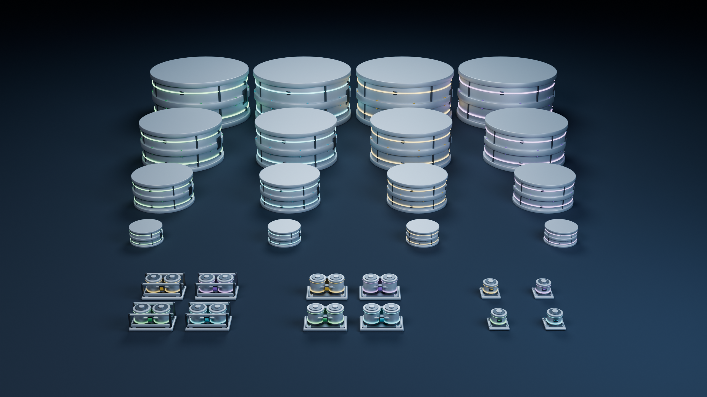

# Acceleration Absorbers



Acceleration Absorbers adds powered modules that reduce the acceleration loads
experienced by your vehicle in [Kitten Space Agency](https://kittenspaceagency.com).
The in-game dashboard shows vehicle G-forces, absorber capacity, electricity use,
and power-limit warnings. Open it from the **Acceleration Absorbers** mod menu.

## Parts

Choose from two radial designs, Compact and Heavy, or inline units in 1 m, 2 m,
3 m, and 4 m lengths. Each form factor comes in four G ratings: **4 G (Green)**,
**8 G (Cyan)**, **12 G (Amber)**, and **16 G (Violet)**. The Heavy Radial also
has a cage-free cosmetic variant.

## Power and balance

Absorber power draw depends on the vehicle's mass and commanded G-load:

```text
requested power = BasePower + vehicle mass (tonnes) × commanded G × k
k = PowerPerGLoad × PowerPerTonne
```

`MaxPower` caps the draw; when a module reaches its cap, it delivers less G than
its rating. For the complete part lineup, power values, and balance details, see
[Parts and Balance](PARTS_AND_BALANCE.md).

All variants have a **10–30 ms response delay**. This is negligible for most
builds, but during abrupt, extreme acceleration changes the unabsorbed portion
can temporarily exceed the vehicle's structural limit.

## XML configuration

The absorber ratings, power values, and delay bounds are configurable per part
in `AccelerationAbsorbers/Content/AccelerationAbsorbersPartsGameData.xml`, in
each part's `<AccelerationAbsorber>` component under `<Components>`. The G
limit and delay bounds are attributes; the power settings are child elements
whose values use a `W` attribute. For example:

```xml
<AccelerationAbsorber MaxGLoad="16" MinDelayMs="10" MaxDelayMs="30">
  <BasePower W="312.5" />
  <MaxPower W="10000" />
  <PowerPerGLoad W="2.3" />
  <PowerPerTonne W="1" />
</AccelerationAbsorber>
```

- `MaxGLoad` sets the absorption ceiling in G.
- `MinDelayMs` and `MaxDelayMs` set the response-delay range in milliseconds.
- `BasePower` is the fixed per-module draw in watts.
- `PowerPerGLoad` and `PowerPerTonne` are multiplied together to set the
  mass- and G-dependent draw described above.
- `MaxPower` sets the per-module power cap in watts. If the requested draw
  exceeds it, the module delivers less G.

Zero values are field-specific:

- `MaxPower W="0"` disables the power cap (uncapped draw); it does not disable
  the module.
- `MaxGLoad="0"` removes the G-load ceiling. Absorption is still limited by
  `MaxPower` and available electricity.
- Set both `MinDelayMs="0"` and `MaxDelayMs="0"` to remove the configured
  response delay.
- `BasePower W="0"` removes the fixed draw. Setting either `PowerPerGLoad W="0"`
  or `PowerPerTonne W="0"` removes the mass- and G-dependent draw.

Requires [StarMap](https://github.com/StarMapLoader/StarMap).

Inspired by the [Andruckabsorber](https://www.perrypedia.de/wiki/Andruckabsorber)
from Perry Rhodan.

**Balance note:** The parts were designed for much higher electricity
availability, not the current power system in KSA `2026.11.16.5901` (as of
`2026-11-19`).

**License:** GPLv3. See [LICENSE](LICENSE).

---

Generated from [KSAModTemplate](https://github.com/AMPW-german/KSAModTemplate).